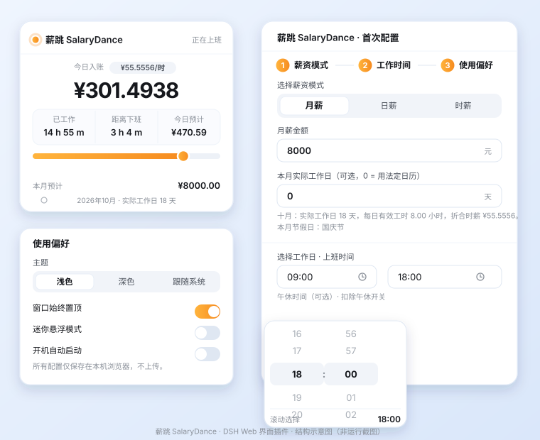

# 薪跳 SalaryDance

> 常驻 DSH Web 界面右上角的实时薪资跳动悬浮卡片。

一块小小的卡片，把「今天赚了多少」变成一个会自己往上跳的数字：今日入账、已工作、距离下班、今日预计，再加一条工作进度轴。点开就是三步设置面板 —— **薪资模式 / 工作时间 / 使用偏好** —— 设一次，之后自动记住。



> 说明：上面这张是界面结构示意图（矢量线框），不是运行截图。真实外观请装上后在 DSH Web 界面里看。

---

## 功能

**悬浮卡片**

| 区域 | 内容 |
| --- | --- |
| 顶部 | 状态灯 + 「薪跳 SalaryDance」+ 当前状态（正在上班 / 还未上班 / 已下班 / 今日休息）|
| 主数字 | 今日入账 `¥301.49`，每秒跳动，千分位分组 |
| 三栏 | 已工作 / 距离下班 / 今日预计 |
| 进度轴 | 今日工作进度，圆点跟随 |
| 速率行 | 跳动速率（时薪，4 位小数） |
| 底部 | 本月预计总额 |

- **可拖动**：按住卡片顶部可以拖到任意位置，自动限制在窗口内。
- **可收起**：右上角 `×` 收起为纯数字小卡片（配合「迷你悬浮模式」）。
- **平滑跳动**：每秒重算一次增量，再用 `requestAnimationFrame` 在两次之间插值，数字连续上涨而不是一秒一顿；`prefers-reduced-motion` 下退化为整秒更新。迷你模式下停止计时，不占用资源。
- **深浅色**：浅色 / 深色 / 跟随系统；默认使用 DSH 主题变量，跟随宿主主题不跑偏。

**三步设置面板**（对齐参考设计稿）

1. **薪资模式** —— 月薪 / 日薪 / 时薪。月薪按**当月实际工作日**（已扣除法定节假日、并计入调休上班日）摊到每天；时薪由月薪、当月实际工作日与每日工时共同决定，**逐月变化**，面板里直接给出当前数值。
2. **工作时间** —— 工作日多选（一~日）、上班时间、下班时间、可选午休时段（不计入工作时长）。时间用**滚动选择器**：鼠标滚轮、触控板、拖动、点击和方向键都能选，松手后自动吸附到中间那一格。**支持跨夜班次**：下班时间早于上班时间即视为次日下班（22:00 → 06:00 可用）。
3. **使用偏好** —— 主题、窗口始终置顶、迷你悬浮模式、开机自动启动，以及当前费率预览（时薪 / 日薪 / 本月实际工作日 / 本月预计）。底部固定显示「所有配置仅保存在本地」说明。

**离线、无账号**：纯前端计算，不发任何网络请求，不需要账号。

---

## 安装

需要 DSH（DeepSeek Harness）桌面版或 Web 版。这是一个 **Web 界面插件**，只在有浏览器的 profile（`desktop` / `web`）里有意义。

### 方式一：命令行（推荐）

```bash
dsh plugin --profile desktop add github:OWNER/dsh-plugin-salary-dance
```

把 `desktop` 换成你要装进去的 profile 名，`OWNER` 换成仓库所属账号。

也可以直接用包名从 npm 装（如果你是从 npm 安装的）:

```bash
dsh plugin --profile desktop add dsh-plugin-salary-dance
```

安装完成后：

- **Web 版**：重启一下 `dsh web`。
- **桌面版**：完全退出 DSH 再重新打开（桌面版的 profile 组合在启动时读取，需要一次重启才能挂上新插件）。

### 方式二：Web 界面里安装

侧边栏 **Plugins → Add plugin**，填入：

```
github:OWNER/dsh-plugin-salary-dance
```

安装向导会读取包信息、跑 pnpm、并把 bundle 加进当前 profile。装完同样需要重启一次。

### 安装后确认

侧边栏 **Plugins** 里应该出现 **薪跳 SalaryDance** 卡片；打开 **Settings → Built-in plugins** 的 Plugin list，可以看到 row id `salarydance` 处于 active。界面右上角会出现小卡片。

---

## 使用

| 操作 | 效果 |
| --- | --- |
| 拖动顶部标题栏 | 移动卡片，位置限制在窗口内 |
| 点击「设置 →」 | 打开三步设置面板 |
| 点击步骤标题 `1/2/3` | 直接跳到那一步 |
| 「下一步 / 上一步」 | 在步骤之间切换 |
| 「完成配置，开始使用」 | 关闭面板，回到卡片 |
| 顶部 `×` | 收起面板 |
| 偏好里打开「迷你悬浮模式」后点小卡片 | 展开回完整卡片 |

**改坏了想恢复默认？** 在浏览器里清掉 `localStorage` 的这个键即可：

```
dsh-plugin-salary-dance/config.v1
```

（打开 DSH 页面 → 开发者工具 → Application → Local Storage。）

---

## 计算口径

设上班 `S`、下班 `E`，跨夜时 `E` 归到次日；午休区间 `[L1, L2)` 可选：

- 班次跨度 = `E − S`
- 每日有效工时 `H` = 班次跨度 − 与班次求交后的午休时长
- 已工作时长 = `clamp(now, S, E) − S −` 落在已过去的午休部分
- 今日入账 = 日薪 × 已工作时长 ÷ `H`
- 今日预计 = 工作日选中的日子取日薪；休息日只计已实际赚到的部分

**当月实际工作日 `D`**（这是时薪的基础）：

```
D = 你选中的星期几在本月的出现次数
    − 落在这些天的法定节假日
    + 落在这些天的调休上班日
```

调休上班日指的是周六/周日被国务院通知改成上班的日子——它们即使不在你选的星期几里也算工作日。

**时薪就是这条链路推出来的，所以逐月变化：**

```
时薪 = 月薪 ÷ D ÷ H
```

例：月薪 8000，十月（`D = 18`，`H = 8`）→ `8000 ÷ 18 ÷ 8 = ¥55.5556/时`；二月（`D = 16`）→ `¥62.5000/时`。时薪固定保留 4 位小数，日薪与月薪保留 2 位。

三种薪资模式都建立在这套费率上：

| 模式 | 日薪 | 本月预计 |
| --- | --- | --- |
| 月薪 | 月薪 ÷ `D` | 月薪 |
| 日薪 | 直接取日薪 | 日薪 × `D` |
| 时薪 | `时薪 × H` | 日薪 × `D` |

**内置的法定节假日表**

已内置 **2025、2026** 两年，逐条抄自国务院办公厅通知原文：

- 2025：[国办发明电〔2024〕12号](https://www.gov.cn/zhengce/zhengceku/202411/content_6986383.htm)
- 2026：[国办发明电〔2025〕7号](https://www.gov.cn/zhengce/zhengceku/202511/content_7047091.htm)

按这套表算出来的每月实际工作日：

| 月 | 1 | 2 | 3 | 4 | 5 | 6 | 7 | 8 | 9 | 10 | 11 | 12 |
| --- | --- | --- | --- | --- | --- | --- | --- | --- | --- | --- | --- | --- |
| 2025 | 19 | 19 | 21 | 22 | 19 | 20 | 23 | 21 | 23 | 18 | 20 | 23 |
| 2026 | 21 | 16 | 22 | 21 | 19 | 21 | 23 | 21 | 22 | 18 | 21 | 23 |

（这些数字有回归测试覆盖，见 `test/math.test.mjs`。）

**表外年份**：目前公告一般在上一年 11 月发布，所以下一年还没到、或年份超出内置范围时，日历退回「周一至周五」，卡片会显示一条提示。你也可以在「薪资模式」里直接手填**本月实际工作日**，填了就以你填的为准（填 0 表示用内置日历）。

跨夜班次下，「已工作 / 距离下班」按同一条时间轴解算：凌晨 02:00 在 22:00→06:00 的班次里读作已工作 4 小时。

## 数据保存在哪

| 数据 | 位置 | 说明 |
| --- | --- | --- |
| 薪资模式、金额、工作日、上下班时间、午休、手填工作日、主题与偏好 | 浏览器 `localStorage` 键 `dsh-plugin-salary-dance/config.v1` | 仅存本机，不上传 |
| 卡片位置 | 组件内存 | 刷新页面后回到默认位置 |
| 插件启用状态 | profile 的 `package.json` / `cordis.patch.yml` | 由 `dsh plugin` 或 Web 插件页管理 |

卡片读不到 `localStorage`（被禁用或配额满）时会退回内置默认值，功能不受影响。

---

## 项目结构

```
dsh-plugin-salary-dance/
├── package.json          # bundle 清单：dsh.bundle.patch + dsh.client
├── cordis.patch.yml      # 向 profile 插入 id 为 salarydance 的 Loader row
├── index.js              # Host 半：空实现（整个功能在浏览器侧）
├── client.js             # 浏览器半：卡片 + 设置面板 + 全部计算
├── icon.svg              # 插件管理器卡片图标
├── locale/
│   ├── zh.json           # 插件标题/描述（中文）
│   └── en.json           # 插件标题/描述（英文）
├── test/
│   └── math.test.mjs     # 无浏览器回归测试：节假日日历、时薪口径、班次解算、文案覆盖
├── docs/preview.svg      # README 里那张结构示意图
├── LICENSE
└── README.md
```

### 它是怎么运作的

DSH 把界面插件组织成 **bundle**：一个 npm 包只要在 `package.json` 里声明 `dsh.bundle.patch`，它的 YAML patch 就会被叠加进 profile 的插件树。

```jsonc
"dsh": {
  "bundle": { "patch": "./cordis.patch.yml" },   // 插入 Loader row
  "client": { "platform": "web", "immediately": true }  // 声明浏览器半 + 启动即载
}
```

- `cordis.patch.yml` 插入一行 `id: salarydance`、`name: dsh-plugin-salary-dance`。
- `index.js` 是 Host 半，导出 `apply()`；这里刻意什么都不做，让 bundle 在没有任何 Web 载体的 Host 上也合法。
- `client.js` 是浏览器半，用 `window.__ModuleLoader__.load({ id, factory })` 注册工厂，`apply(ctx)` 里：
  - `ctx.effect(installStyles)` 注入样式表；
  - `ctx.effect(() => ctx.locale.register(...))` 注册中英文字典；
  - `ctx.slots.inject('shell.overlay', () => ctx.slots.register({...}))` 把组件挂到宿主已声明的浮层插槽上。

因为注册都挂在 `ctx` 的 effect 上，插件被禁用或卸载时样式、字典、插槽注册会一起回收。样式只使用 DSH 主题变量（`--dsw-alias-*`、`--dsw-radius-*`、`--dsw-shadow-*`），不 import 任何 DSH Client 包。

---

## 开发

```bash
git clone https://github.com/OWNER/dsh-plugin-salary-dance.git
cd dsh-plugin-salary-dance

# 口径回归测试（不需要浏览器、无依赖）
npm test

# 链接进你的 profile 调试
dsh plugin --profile desktop add "$PWD"
```

改完 `client.js` 后：

- 若宿主开着 HMR，刷新页面即可拿到新 bundle（bundle 版本号按文件 mtime/size 计算）。
- 否则重启 `dsh web` / 桌面版。

仓库刻意不引入构建步骤：`client.js` 就是产物，纯 JS + `React.createElement`，没有 JSX、没有打包器、没有运行时依赖，改一行刷新就能看到效果。

---

## 兼容性

| 项 | 值 |
| --- | --- |
| 类型 | DSH Web 界面插件（bundle） |
| 适用 profile | `desktop`、`web` 等带浏览器载体的 profile |
| 不适用 | `tui`、`headless` 等无浏览器载体的 profile（Host 半合法但不会有界面） |
| DSH 版本 | 在 `0.2.0-rc.2` 上开发与验证 |
| Cordis | `~4.0.4` |
| 运行时依赖 | 无 |
| 网络 | 不使用 |

`client.js` 只用两样宿主能力：插槽服务与 locale 服务（在 `inject = ['slots', 'locale']` 里声明）。两者都缺失时插件不会挂载，而不是抛错。

---

## 已知限制

- 节假日表只内置到 **2026 年**；2027 起需要补表，否则退回周一至周五（卡片会提示，也可以手填工作日）。
- 今日预计按 **工作日** 判断，用的是你选的星期几；法定节假日当天不算工作日，但调休上班的周末算。
- 卡片位置不持久化，刷新后回到右上角。
- 「开机自动启动」是界面偏好：插件的挂载时机由 DSH 进程决定，本插件无法自行拉起进程。
- 月薪按当月工作日摊算，月内天数不同的月份日薪会略有差异，这是刻意设计（和参考稿一致）。

---

## License

[MIT](LICENSE)
